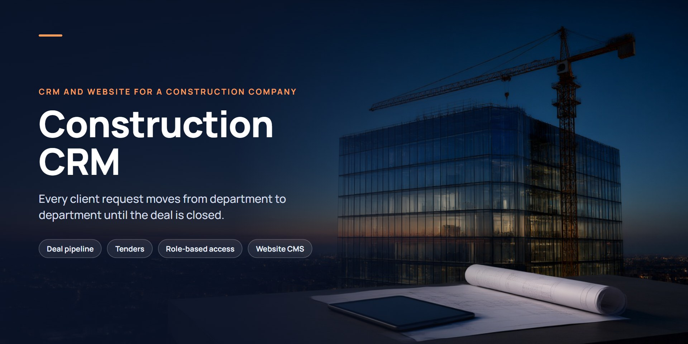
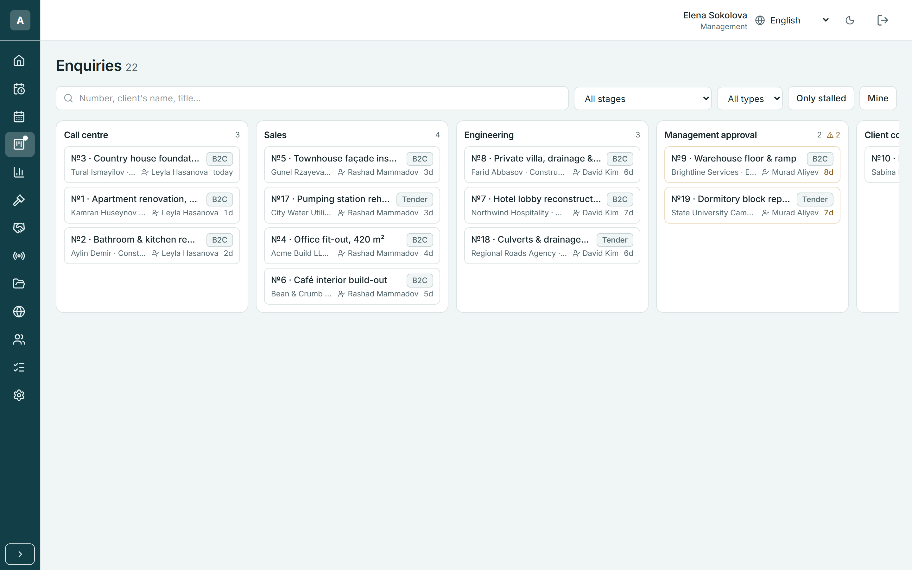
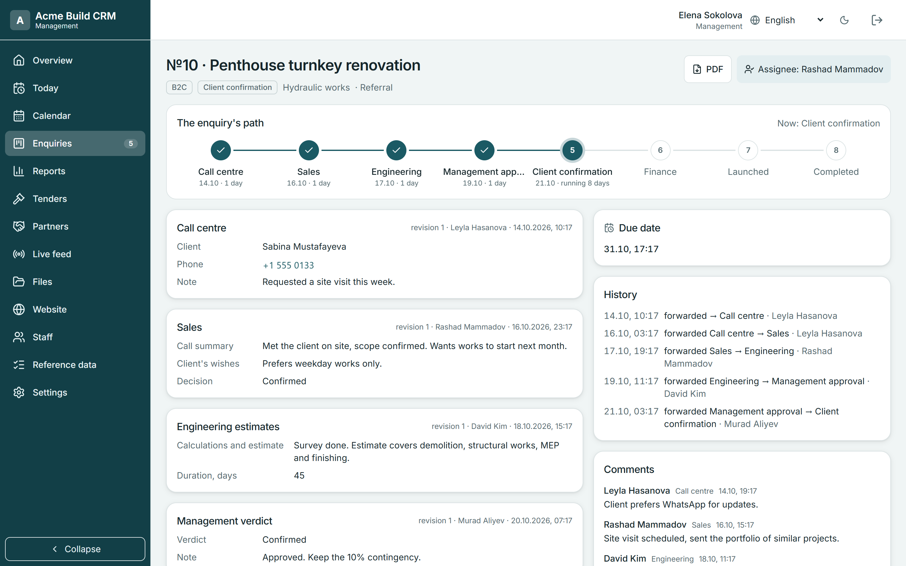
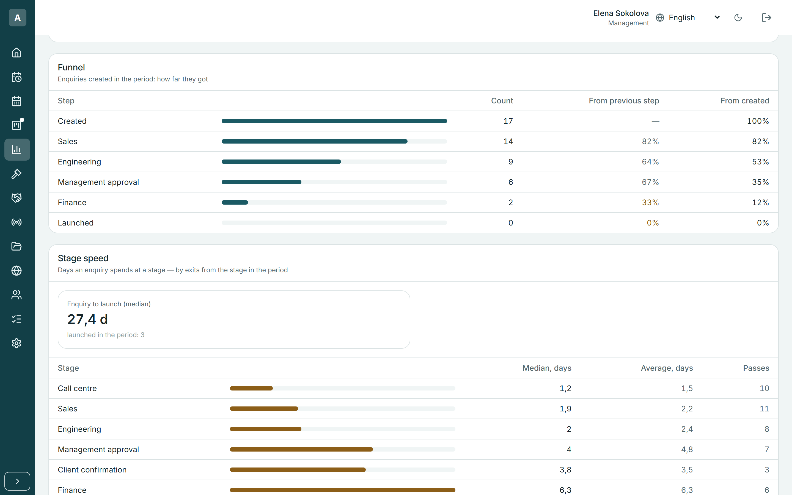
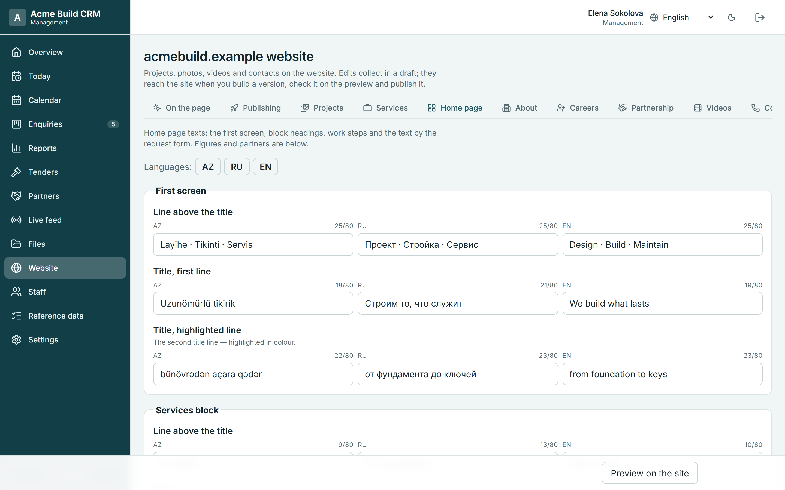
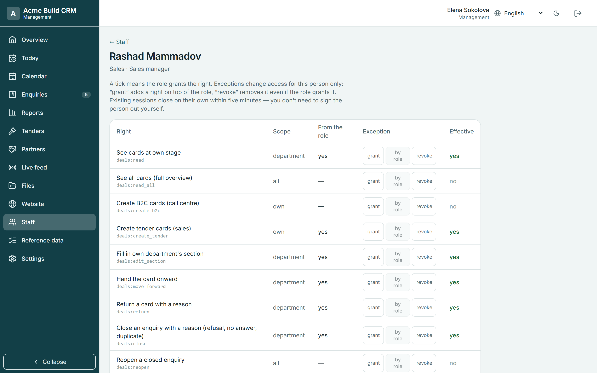

  

# Construction CRM

**CRM and company website for a construction company.** One system where every client request moves from department to department until the deal is closed — for private clients and public tenders alike.

## Who it's for

Construction and renovation companies where a single job passes through several teams — call centre, sales, engineering, management, finance — and where management needs to see where each deal is and how long it has been there.

## Key features

- **Deal pipeline across departments.** Each deal card passes through the call centre, sales, technical and admin teams. Every department fills in its own section, hands the card on or returns it with a reason.
- **Private clients and public tenders** on one board, each with its own path and fields.
- **Full history on the card.** Stage path with time spent at each step, revisions of every section, comments, files and estimates.
- **Management reports.** Funnel by stage, time at each stage and stalled deals.
- **Role-based access.** Each role sees only what it needs; rights come from the role, with per-person grant/revoke exceptions.
- **Website managed from the CRM.** The marketing team edits the company website — projects, services, careers, home-page texts in three languages — previews a draft and publishes it, without a developer.

## Platforms

Web application (desktop and mobile browsers), interface in English, Russian and Azerbaijani. The public company website is generated from the CRM content.

## Screenshots

All screenshots use demo data with fictitious companies and people.

**Deal pipeline** — every enquiry moves through call centre, sales, engineering and management approval; private and tender deals on one board.

**Deal card** — stage path, each department's section with revisions, history and comments.

**Management reports** — funnel by stage and time spent at each stage.

**Website editor in the CRM** — trilingual home-page texts, edited as a draft, previewed and published.

**Role-based access** — rights granted by role, with per-person exceptions.

## Stack

TypeScript · Next.js · React · NextAuth · Prisma · PostgreSQL · static site generation · Linux

## Source code

Source code is private — demo on request.

## Contact

Zulfi Aliyev · alliyev.zulfi95@gmail.com · [sci-fi.az](https://sci-fi.az) · [LinkedIn](https://www.linkedin.com/in/zulfi-aliyev/)
